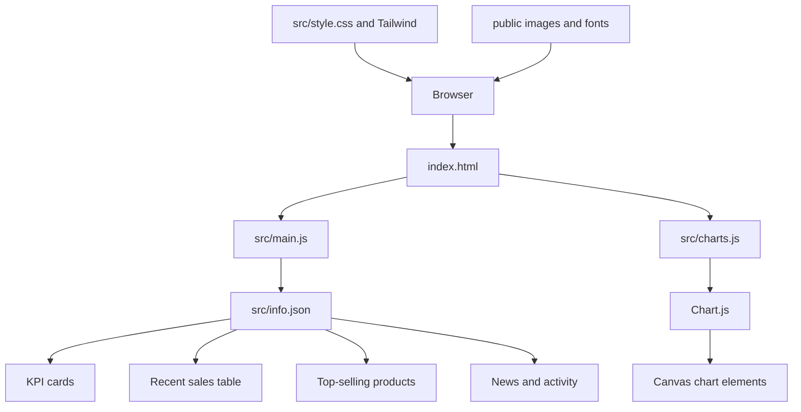

# Architecture

## Runtime
Vite serves the static entry page and source modules. `main.js` toggles the sidebar and fetches the local JSON file to populate several dashboard regions. `charts.js` initializes line, radar, and doughnut charts through the Chart.js global.

There is no server-side data service in this repository.
